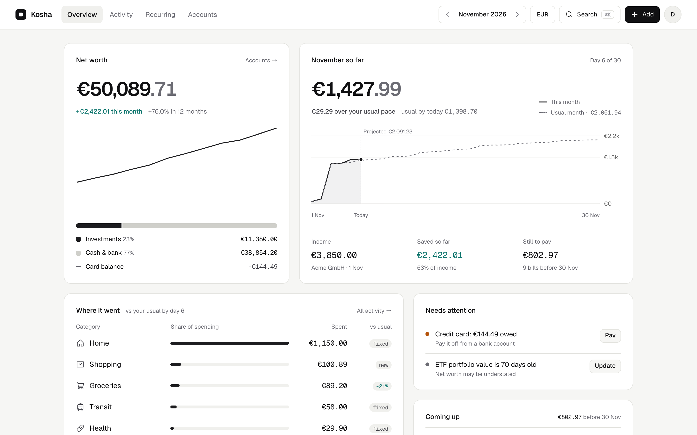

<p align="center">
  <picture>
    <source media="(prefers-color-scheme: dark)" srcset=".github/assets/logo-dark.svg">
    
  </picture>
</p>

<p align="center"><strong>Every account. Every currency. One treasury.</strong></p>

<p align="center">A personal finance tracker for people with money in more than one place and more than one currency.<br><a href="https://getkosha.app">getkosha.app</a></p>

<p align="center">
  <picture>
    <source media="(prefers-color-scheme: dark)" srcset=".github/assets/screenshot-dark.png">
    
  </picture>
</p>

Kosha (कोश, "treasury") keeps every account in one place: bank accounts, cash, credit cards and investments, in any currency. On a phone it is a quick-entry app you can install from the browser. On a desktop it is a dashboard that shows where your money went and where it stands.

## What it does

- **Net worth across currencies.** Totals convert at daily exchange rates. Credit cards count what you owe, and investments count what you put in plus their latest gain.
- **Quick setup.** A new account opens on a welcome screen: confirm your name, main currency and time zone (guessed from your browser), then add your bank accounts, cards, cash and investments in one go, each with what it holds today. Every step can be skipped.
- **The current month.** Spending so far against your usual pace, a projection to the end of the month, and the bills still to pay.
- **Fast entry.** Type one line, like `12.50 groceries yesterday`, and Kosha fills in the amount, category, date and account. Categories are also guessed from payees you have entered before.
- **Tags and events.** Tag entries with hashtags (`#work`, or type them in the one-line entry). Create an event such as a trip with its dates, and everything you add during it is filed under it, so Activity can show what the whole trip cost. Click a tag on any entry to see every transaction with it, from any month.
- **Subscriptions and bills.** Set a schedule once. Payments are recorded when they fall due, and you can skip or edit a single one.
- **Transfers and currency exchange.** Moving money between your own accounts never counts as spending. For exchanges through Wise or similar, Kosha shows the fee and the cost of the provider's rate against the market rate.
- **One account per person.** Each person sees only their own data. Sign in with a password or a passkey, with optional two-factor codes.
- **Start from your statements.** A new account opens with a banner that takes every statement you have, from every bank and card and as many months as you like, all at once. Kosha sorts the files into accounts (by account number, or the bank's format), counts lines that appear in two statements once, links transfers between your own accounts, and names and sorts each payee from well-known merchants and your rules (and AI, when it's on). You check the result by payee, where a new name or category applies to every transaction from that payee, before anything is saved. Each account then gets an opening balance that makes it meet its latest statement, and is reconciled to it. An account you already had keeps today's balance. **Import statements** is also in search and in Settings › Import & export.
- **Bank statements and reconciliation.** Drop a CSV, OFX or QFX file from your bank on **Reconcile** (from Accounts, or Settings › Import & export). Kosha works out the columns, remembers them for that bank, ticks every entry that matches a statement line (a few days of posting delay allowed), lists what's missing so you can add it in one go, and flags amounts that are close but not the same, such as a tip. A live bar shows the statement balance, what's ticked and the difference. When it doesn't add up, Kosha runs the bookkeeper's checks: an entry equal to the difference, half of it (a wrong sign), digits swapped (a difference divisible by 9), a misplaced decimal point, a duplicate, or entries at the period's end that will show on the next statement. Finishing marks the entries reconciled, Kosha warns before you change one, and the latest reconciliation can be undone. No file? Tick entries against the statement by hand, or confirm in one tap that your bank shows the same balance.
- **Recurring payments, spotted.** Recurring lists payees you pay on a steady rhythm (weekly to yearly) that aren't set up yet. One tap makes one a recurring payment and files its past payments under it.
- **Import from Cashew.** Bring over accounts, categories, transactions and recurring payments.
- **Optional AI, with your own key.** Connect Anthropic, OpenAI, Gemini, OpenRouter, Ollama or any OpenAI-compatible endpoint in Settings › AI, and turn on what you want:
  - **Auto-categorise** picks a category, marked ✦, for a payee no rule or past entry can place.
  - **Natural-language add** reads a sentence such as `lunch with Sam at Nando's 18.50 last friday` in quick add, or from **Describe it** on the phone add screen.
  - **Receipt scanning** reads the amount, date, time and payee from a photo, converting a receipt in another currency.
  - **Monthly recap** puts a short note on Overview in the first week of each month: what changed, and why.
  - **Ask Kosha** answers questions about your money from your data, with links to the entries behind each answer.
  - **Statements** reads PDF statements (checking that the lines add up to the closing balance), works out CSV files Kosha can't read alone from their column names only, turns bank text into payee names and categories, and explains a reconciliation difference.

  **What AI can see** decides which fields are sent. Hidden payees and accounts go out as codes, and Kosha puts the real names back in the replies. Each request can be kept in a 30-day log, so you can check what was sent. Nothing is sent while AI is off, and a feature that is off leaves no trace in the app.

- **API and MCP.** Everything you can do in the app is also a REST endpoint and a tool for AI assistants such as Claude, ChatGPT and Cursor. Writes work in bulk, up to 500 entries at a time.

## Run it locally

You need Node.js 22.18 or later, because the scripts run TypeScript files directly.

```sh
npm install
npm run db:migrate   # create the local D1 database
npm run db:demo      # optional: a demo account with sample data
npm run dev          # http://localhost:3000
```

Create `.dev.vars` with three values:

```sh
BETTER_AUTH_SECRET=   # 32+ random characters, e.g. from `openssl rand -hex 32`
BETTER_AUTH_URL=http://localhost:3000
AI_KEY_SECRET=        # 32+ random characters; encrypts AI provider keys (Settings › AI)
```

The demo account is `demo@kosha.local` with the password `kosha-demo-2026`. It has about 14 months of invented data, and running `npm run db:demo` again resets it.

The demo account is read-only: the server refuses every change it tries to make, in the app, the API and its sign-in settings. That makes it safe to seed in production with `npm run db:demo:remote`, which also turns on **Try the demo** on the landing page. Its data ends on the day you seed it, so re-run that now and then. To try features that write as the demo user locally, add `DEMO_WRITABLE=1` to `.dev.vars`.

`npm test` runs the self-checks for money parsing, time zones, categorising and subscriptions. `npm run typecheck` (tsrs), `npm run lint` (oxlint), `npm run check` (oxfmt) and `npm run knip` (unused code and dependencies) check the rest.

## Deploy to Cloudflare

Kosha runs on a single Cloudflare Worker with a D1 database. Production is at https://getkosha.app, and every push to `main` deploys it through Workers Builds.

`npm run deploy` builds the app, applies new D1 migrations, then deploys the Worker. Workers Builds runs the same command.

To set up your own copy:

```sh
npx wrangler d1 create kosha                  # copy the database_id into wrangler.jsonc
npx wrangler secret put BETTER_AUTH_SECRET    # 32+ random characters
npx wrangler secret put AI_KEY_SECRET         # 32+ random characters; changing it makes saved AI keys unreadable
npm run deploy
```

Profile pictures are stored in Cloudflare R2, which asks for a payment card on the account even on the free tier. They are optional:

- **With R2:** run `npx wrangler r2 bucket create kosha-avatars` once before you deploy.
- **Without R2:** delete the `r2_buckets` block from `wrangler.jsonc`. Everything else works, and Settings › Profile shows initials and says photos aren't set up.

Before you deploy, set `BETTER_AUTH_URL` under `vars` in `wrangler.jsonc` to the public URL of the app. Passkeys only work on this domain.

To deploy on every push, connect the repository under the Worker's **Settings → Build**. Use `npm run deploy` as the deploy command and leave the build command empty. The build token needs **D1: Edit** for the migration step, which the token Cloudflare creates by default does not have.

## API and MCP

Settings › **API & MCP** has what you need:

- **AI assistants.** Add `https://<your Kosha>/mcp` as a custom connector in Claude, ChatGPT or Cursor. The assistant opens Kosha's sign-in and asks you to allow it, read-only or with changes. Connected apps are listed there, and **Disconnect** cuts one off at once.
- **Scripts.** Create an API key (read only, or read & write) and send it as `Authorization: Bearer kosha_…`. The key is shown once; only its hash is stored.
- **Reference.** `/api/v1/docs` lists every operation with its fields and examples, and `/api/v1/openapi.json` is the OpenAPI 3.1 document.

```sh
curl https://<your Kosha>/api/v1/transactions -H "Authorization: Bearer kosha_…" \
  -H "Content-Type: application/json" \
  -d '{"transactions":[{"accountId":"main","payee":"Tesco","amount":-2350}]}'
```

Amounts are in cents, and negative means money out. Leave out `categoryId` and your payee rules choose it, then the AI model when Auto-categorise is on. Each user can make 120 requests a minute.

Statements and reconciliation work the same way: `check_statement` reads a CSV, OFX or QFX file (or a PDF, with AI) and matches it against an account, `create_transactions` adds the missing lines with each line's `bankRef`, and `reconcile_account` finishes. `list_recurring` with `includeSuggestions` lists the regular payments Kosha spotted. The AI features are operations too (`read_transaction`, `ask_kosha`, `recap_month`). They use the model connected in Settings › AI, and without one they answer `409 ai_unavailable` with what to turn on.

Cursor passes only the first 40 tools to its agent, so the AI tools and the rarely needed undo and dismiss ones come last. Switch off tools you don't use in Cursor if you want those.

The API leaves out sign-in and security settings, AI provider keys, full exports and Delete & reset. Use the app for those.

## Import from Cashew

Sign up first, then import a Cashew backup into that account:

```sh
npm run import:cashew -- ~/path/to/cashew-backup.sql you@example.com > import.sql
npx wrangler d1 execute kosha --local --file import.sql    # or --remote
```

Running the import again updates accounts in place and keeps their type, credit limit and gains. Recurring transactions become subscriptions, and transfer pairs are linked.

## How things are counted

| Account type | Its balance means    | Net worth counts                              |
| ------------ | -------------------- | --------------------------------------------- |
| Bank or cash | money in the account | the balance                                   |
| Credit card  | credit left to spend | balance minus the credit limit (what you owe) |
| Investment   | money put in         | balance plus the latest recorded gain         |

- **Gains.** On **Accounts**, use **Update gains** and enter either today's value from your broker or the gain itself. Gains are kept as a dated history, so the net worth chart moves on the day you record each one.
- **Transfers** are two linked rows, one out and one in. When the currencies differ, each side keeps its own amount. An exchange fee is saved as its own expense under **Transfer fees**.
- **Recurring transfers** with a fixed amount are recorded automatically. If the amount changes each time, Kosha lists it as due and asks you for the amount.
- **Events.** A new entry dated inside an event's dates joins that event unless you pick another one or none. Recurring payments never join one on their own. Filtering Activity by an event shows all of its entries, whatever the month. Deleting an event keeps its entries.
- **Subscriptions.** Editing a subscription changes only future payments. Deleting a paid payment marks it as skipped, so it is not added back.

- **Offline.** The installed app opens without a connection and shows the pages and data from your last visit. New entries from **Add** wait on the device and sync when you're back online. Edits, transfers and deletes still need a connection. Signing out clears what the device saved.
- **Updates.** When a new version is deployed, a card at the bottom offers to reload into it.

## Built with

TanStack Start (React 19, Vite), shadcn/ui on Base UI, Tailwind CSS 4, Recharts, Better Auth, and Cloudflare Workers with D1.
